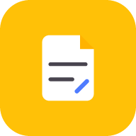

<div align="center">
  

# WriteOn: Simple Notepad ✅
A clean, intuitive note-taking app with *Material You* design — open source and privacy-respecting.

[](https://github.com/Brandontake/Writeon/releases)
&nbsp;
[](https://f-droid.org/en/packages/com.ezpnix.writeon/)
</div>

---

<div align="center">
  
  
  
</div>

---

## ✨ About

WriteOn is an offline-first notepad for Android. Notes, tags and attachments live in a local Room
database — there is no account, no sync service and no analytics. The interface follows Material 3
and picks up the wallpaper colours, with optional AMOLED and "extreme AMOLED" themes
for people who want a true black background.

It is a small app by design: two APK variants of a few megabytes, no runtime permission prompts, no
foreground services, and only the permissions the features actually need.

---

## 👋 Features

**Writing**
- Markdown editing with an expanded 5-item-per-page formatting toolbar (headings `##`, hyperlinks `[](url)`, horizontal dividers `---`, quotes `>`, code blocks, checkboxes, bullet/ordered lists, bold / italic / underline / strikethrough / highlight / inline code, tables, indentation, escaping of Markdown characters, images, mic recording and timestamps). A style wraps the selected text, or lands at the caret when nothing is selected, and the toolbar docks under the note so it never covers what you are writing
- Underline `_text_`, real tables (`| a | b |`, with a header row), four-space indentation and `\`-escaping for the characters that would otherwise become markup; `##` renders a small heading while `#` and `###` render larger, so one note can carry a title above its sections
- Note attachments stored as ordinary Markdown links (`` for images, `[Recording name](attachment://…)` for audio), audio recording & in-app playback with a draggable seek bar, 0.5×–2× speed control, per-recording renaming and save-to-folder export, plus automatic cleanup of a note's attachments when it is deleted
- **Live attachment preview (experimental, opt-in).** A line that is only an image or recording link can render as the same block the reader draws while the body stays plain Markdown; edit the source line, delete a block, rename a recording, or open an image full screen. Turn it on in Settings → Behaviour; the classic editor stays one switch away
- Keyboard-aware editor scrolling keeps the caret visible when the keyboard opens, and preview text can be selected and scrolled without losing its selection handles
- Dynamic theming support across notes and flashcards, customizable font size and persistent custom local font import (.ttf/.otf), grid or column layout, minimalistic mode, adjustable corner radius
- Diverse sorting dimensions (Creation Time, Last Modified Time, Title) with dedicated Ascending/Descending controls
- Note details dialog with Last Modified Time tracking and Word/Character stats
- Launcher App Shortcut for quick note creation
- UI available in English, 简体中文 and 日本語 — switchable inside the app or through the system per-app language picker

**Privacy**
- App lock with biometric authentication, PIN (PBKDF2-HMAC-SHA256, 600 000 iterations) or pattern, a 5-attempt lockout and screen protection
- Note titles and bodies can be encrypted with an Android Keystore AES-256-GCM key before they reach the database
- The optional note-vault password uses PBKDF2-HMAC-SHA256 with a per-note random salt (120 000 iterations), with read-only compatibility for notes written by earlier builds
- Home-screen widgets honour the app lock — with a lock configured they show a placeholder instead of note text

**Extras**
- Adaptive Material 3 & HyperOS home-screen widgets (free-form resizing with 24dp rounded corners, vertically centred note text, quick add + note preview), built-in calendar, calculator, scratchpad and dynamic-themed flashcards
- Share text or images into the app from any other app's share sheet; each share opens a new note, and shared images are copied in as attachments
- Save a note as a WebP card that uses the app's Material 3 surfaces and the font size from
  Settings — the whole note goes into one tall picture instead of numbered pages — export to
  TXT/Markdown, and local backup / restore (password-encrypted by default, and always encrypted
  when the library holds Vault notes). WebDAV uploads check the server's copy before replacing it,
  so a backup written by another device is never silently overwritten: an unreadable or
  unvalidated remote is refused instead of guessed at, the newer upload is kept beside it under its
  own name, and the cloud screen shows where that copy went
- Trash search, a note count beside every drawer item and tag, an **Untagged** filter plus long-press multi-select tag deletion that only removes tags (never notes), ten-second undo after a save, and a note you empty is moved to the trash instead of lingering as a blank row
- One menu per recording in the editor: save to folder, rename, edit the Markdown line and delete the attachment all live in the same overflow instead of behind two competing buttons; the editor-behaviour switches (Markdown, LaTeX, live attachment preview, show-only title) live in Tools as one grouped card block
- Layout that scales from phone to tablet: the home grid adds columns with the available width, the editor caps its text column at a readable width and opens the split preview on any tablet at least 720 dp wide, and settings stay at a centred 840 dp maximum with a two-column card grid on wide screens
- Audit-hardened privacy and accessibility: enabling or engaging the app lock immediately redacts widgets and drops pinned notifications, an unlocked Vault re-locks after the background grace period even when no app lock is set, the pattern grid and PIN indicators have screen-reader actions, and the quick-action button works with TalkBack and hardware keyboards


---

## 🔒 Privacy & permissions

- **Permissions are requested only when they are needed.** Nothing is asked at launch. The microphone permission is requested the first time a recording is inserted into a note, and the notification permission only when a note is pinned to the shade; both are optional and the feature degrades instead of crashing when they are denied. No storage, location or network-state access is ever requested.
- **Everything stays on the device.** Note data lives in a local database; the optional cloud backup is a user-configured WebDAV target and nothing is uploaded anywhere by default.
- **Encrypted at rest.** When encryption is enabled, note titles and bodies are sealed with a per-device Keystore key. The note id, pin flag, timestamps and tags stay readable so that ordering, pinning and the tag filter keep working without extra queries — which also means **a database file copied off the device without "Export backup" cannot be read back**.
- **Database backups are encrypted by default**, and a library that holds Vault notes always forces a password: the archive contains a portable database, the attachment tree and the Vault salt, so a plaintext copy would expose content the app otherwise keeps sealed.
- **Backups are replaced atomically.** A restore stages the new database next to the live one, verifies its SQLite header, renames it into place and keeps the previous file as `.bak`. An interrupted or corrupt restore leaves the existing notes intact instead of deleting them.
- **Archive entries cannot escape the target directory.** Backup archives are extracted through a canonical-path check, so an entry named `../../databases/note-list.db` is rejected rather than written.
- **Locked means locked.** With an app lock configured, the home-screen widgets render a "open the app to view this note" placeholder instead of note text, and pinned-note notifications are marked private; enabling a lock also refreshes already-rendered widgets and notifications. An unlocked Vault re-locks after the background grace period even when no app lock is configured.
- **Permanent deletion asks first.** Removing notes from the recycle bin — in bulk or via long-press — is confirmed in a dialog.

---

## 🔋 Battery and memory

The app is deliberately quiet when it is not on screen. A full audit of the v1.10 sources turned up four things that broke that rule, and all of them are fixed:

- **Audio playback** used to repaint the player card ten times a second and kept a main-looper ticker alive even after a stream failed to open. The ticker now runs at 4 Hz, stops on error or completion, and releases the codec instead of holding it. Playback still requires the app to stay open — there is no background media service, so nothing keeps the device awake once you leave.
- **Recording** released the microphone on every exit path. An exception thrown by `MediaRecorder.stop()` — which is what happens when a recording is too short — used to skip `release()`, leaving the mic open and the privacy indicator lit until the process died.
- **The recorder dialog** drove an endless pulse animation while it was idle, so the screen was repainted every frame for as long as it was open.
- **Desktop widgets** declare no `updatePeriodMillis`, so the launcher never wakes the app on a timer; widgets refresh when the note data changes.

Memory is bounded rather than proportional to the note: exporting a note to a picture is clamped to an 8 MP budget (about 32 MB) and every intermediate bitmap is recycled, so the user with the longest note no longer runs out of heap. Recording is 64 kbps mono — roughly 7 MB per hour of audio.

---

## 📥 Download

- **GitHub Releases:** <https://github.com/Brandontake/Writeon/releases>
- **F-Droid:** <https://f-droid.org/en/packages/com.ezpnix.writeon/>

Both APK variants are minified and shrunk, so the download stays in the low single-digit megabytes.

---

## 🧱 Build from source

**Requirements:** JDK 21, an Android SDK with the API 37.2 platform and build-tools 36.0.0, and the
Gradle wrapper that ships in this repository (Gradle 9.9.2, AGP 9.5.2, built-in Kotlin 2.3.21).

```bash
./gradlew assembleDebug      # debug APK  (R8 + resource shrinking, debug keystore)
./gradlew assembleRelease    # release APK (upload keystore when keystore.properties exists)
```

The project produces **APK files only** — there is no App Bundle task in the release flow.

Release signing is required for a real release: create `keystore.properties` in the repository root
with `storeFile`, `storePassword`, `keyAlias` and `keyPassword`. A release build without that file
**fails** instead of silently producing a debug-signed APK; pass `-PallowDebugSigning=true` only for a
deliberately local artifact (its `versionName` gets a `-debugsigned` suffix). The published release is
signed with the project's upload key (`CN=Brandontake, OU=WriteOn, O=WriteOn`).

Two things to get right when you create that file:

- **Write it without a BOM.** Windows PowerShell 5.1's `Set-Content -Encoding UTF8` emits a BOM, which
  `Properties.load()` folds into the first key name, so `storeFile` comes back `null` and the build dies
  with `path may not be null or empty string. path='null'`. Use `-Encoding ascii`, or write it from an
  editor that saves UTF-8 without a BOM.
- **`storeFile` is relative to the repository root**, not to `app/`, because `app/build.gradle.kts`
  resolves it with `rootProject.file(...)`. For a keystore at the repo root, use `writeon-upload.jks`,
  not `../writeon-upload.jks`.

Both `*.jks` and `keystore.properties` are gitignored — keep them that way, and back the keystore up
somewhere safe. Without it you cannot publish an update that replaces a shipped build.

### Toolchain notes

- `compileSdk` is **37.2 (Android 17)**, `targetSdk` **36 (Android 16)**, `minSdk` **33 (Android 13)**
  as of v2.1. The compile SDK is only 37.2 because the current Compose BOM requires at least 37.1;
  target 36 keeps the 2.1 runtime-behaviour contract unchanged.
- Toolchain: **Gradle 9.9.2**, **AGP 9.5.2** with built-in Kotlin **2.3.21** (the standalone
  `org.jetbrains.kotlin.android` plugin is no longer applied), **KSP 2.3.14**, **Compose BOM
  2026.11.01** (Compose 1.13, Material 3 1.5), **Room 2.7.2**, **Hilt 2.60.1** and the stable
  **biometric 1.1.0**. `android.suppressUnsupportedCompileSdk` is gone.
- Room 2.8.x is not used yet: its new `MigrationTestHelper` SQLite driver rejects the absolute
  database path that the migration tests use. Room 2.7.2 is the upgrade target until that harness is
  migrated; the rest of Room (Flow, KSP2, schema export) is on the new major line.
- At `minSdk >= 28`, AGP's `packaging.dex.useLegacyPackaging` default becomes `false`, so the 2.1 APK
  stores dex uncompressed: the APK is larger than 2.0.4's (~7.7 MB vs ~4.2 MB), but installation no
  longer extracts the dex, so the installed footprint shrinks. Not a regression.
- Kotlin is compiled by AGP's built-in Kotlin support with the Compose compiler plugin; KSP still
  drives Room and Hilt.

### What keeps the APK small

- R8 code shrinking/optimisation **and** resource shrinking are enabled for **both** build types; the
  unused icons of `material-icons-extended`, unused AndroidX classes and unreferenced resources are
  all removed (icons and library classes are only kept when a source file actually uses them).
- The resource configuration list limits the app to the `en`, `zh` and `ja` translations that exist, so
  no library locale resources are packaged.
- No Material 2 dependency, no unused libraries, and lossless WebP artwork for the widget previews.
- No foreground services, no extra permissions and no native libraries beyond two tiny `.so` files
  shipped by AndroidX.

### Android 16 behaviour changes

Edge-to-edge is enforced and `windowOptOutEdgeToEdgeEnforcement` is ignored (the app never declared
it and already draws edge-to-edge with explicit insets). Predictive back is enabled for `targetSdk`
36: the app declares `android:enableOnBackInvokedCallback="true"` and offers a Predictive Back
toggle in **Settings → Colors & styles** that scales/fades the UI during the gesture. Native
libraries must be 16 KB page aligned — all packaged `.so` files (2 libraries × 4 ABIs) already load
with `p_align = 16384`.

Background work: the JobScheduler quota optimisations can delay or stop background jobs, and
`JobInfo#setImportantWhileForeground` is ignored from Android 16 (its getter returns `false`).
Automatic backups are periodic WorkManager work, so this changes *when* they run, not whether the
feature works; a WorkManager 2.10.x upgrade is queued for its new diagnostics
(`JobScheduler#getPendingJobReasons*`).

Play deadlines: new apps and updates must target API 36 since 2026-08-31 (extension requests until
2026-11-01), and from 2027-02-01 updates must support 16 KB page sizes — WriteOn already does.

### How the build is verified

Both variants were built on **2026-10-31** with `:app:testDebugUnitTest`, `:app:lintDebug`,
`:app:assembleDebug` and `:app:assembleRelease` (offline, JDK 21.0.12.1, Gradle 8.9). The figures below
are from the **latest** release build, which carries the 2.0.4 fixes (global save/delete undo,
off-main-thread media copies, attachment indices in schema v11, reflection-free settings, and the
presentation/data split for the backup workers) plus the earlier acceptance fixes (database restore no
longer truncates the restored file, pin/tag writes can no longer overwrite unsaved text, backups now
include attachments and are encrypted end to end, WebDAV first uploads refuse to overwrite another
device's copy, restore asks for confirmation, picked images live in internal storage) plus the
second-round follow-up (streaming backup/restore with size budgets, an automatic-backup restore
entry, exponential app-lock backoff on a monotonic clock, and restored recordings are deletable again)
plus the sixth-round acceptance fixes (undo can no longer cross-write the title into the body, the
undo history is bounded and coalesced, deleting a note no longer crashes its open editor, new notes
claim the id their own transaction returned, Keystore failures refuse to overwrite ciphertext, the
note vault is visible and unlockable again, cleartext `http://` WebDAV is allowed for self-hosted
LAN servers (the Basic-auth trade-off is documented in `Cloud.kt`), backup/restore outcomes are
surfaced, and Android auto backup excludes the whole
database directory), and the release-gate follow-up (rows that fail to decrypt now degrade in place
behind a home-screen banner instead of crashing the list, WebDAV uploads stage to a temporary name
and MOVE into place with Content-MD5 verification, no-ETag servers fall back to Last-Modified
preconditions or refuse to overwrite silently, backup archives carry a manifest the restore dialog
shows before anything is replaced, and the Room 6→11 migration chain is covered by Robolectric
tests), plus the seventh-round WebDAV and accessibility pass (retry classification with an attempt
ceiling, redirects refused instead of being replayed as a `GET`, stale-ETag 412 loops broken, conflict
copies created conditionally, whole-call timeouts with a download ceiling and a free-space check,
network-constrained work, a paged instead of all-in-memory export, legacy vault notes re-sealed on
unlock, and the AA-contrast / 48 dp / screen-reader fixes the accessibility audit listed):

| Variant | Size | applicationId | Notes |
| --- | --- | --- | --- |
| Release | **3.91 MB** (4,102,355 bytes) | `com.ezpnix.writeon` | full R8 optimisation + obfuscation; carries the baseline profiles its dependencies ship (AGP merges the AAR `baseline-prof.txt` files into `app/release/baselineProfiles/{0,1}` — the app has no hand-authored profile of its own); signed with the project's upload key (`CN=Brandontake, OU=WriteOn, O=WriteOn, C=US`) |

SHA-256 (Release): `DCAA299BE0E0428D1086089C593F6B86AC3AA3AD7DEA831D8047AA0BAC750DB5`.

Both report `versionCode 16` / `versionName 2.0.4`, `minSdk 26`, `targetSdk 36`, the default + `ja` + `zh`
locales, and four ABIs. (These are the published 2.0.4 artifacts; the 2.1 line raises `minSdk` to 33.) The database moved to **v11** (`MIGRATION_10_11`), which indexes the
`attachments.trashed_at` and `attachments.type` columns the library and recycle bin filter on;
`app/schemas/.../11.json` is checked in, so the migration is testable offline instead of only on a
device.

Beyond the build: `aapt2 dump badging` on both APKs, `apksigner verify` on both, `aapt2 dump resources`
to confirm the new strings actually landed in the packaged resources, and the R8 mapping files in
`app/build/outputs/mapping/{debug,release}/mapping.txt`. The release APK declares five permissions
(`INTERNET`, `POST_NOTIFICATIONS`, `RECORD_AUDIO`, `RECEIVE_BOOT_COMPLETED`, `ACCESS_NETWORK_STATE` —
the last one is what lets WorkManager evaluate the `NetworkType.CONNECTED` constraint on the backup
work) plus the two biometric permissions the library merges in; `WAKE_LOCK` and `FOREGROUND_SERVICE`
are still removed.

`lintVitalRelease` and `:app:lintDebug` both ran (0 errors; 75 warnings on `lintDebug`);
`testDebugUnitTest` covers **138 tests** in 18 suites — including the
`DatabaseRestoreTest` restore regressions (bytes preserved + `.bak` kept, corrupt archive rejected,
zip-slip members refused, oversized members refused), `BackupArchiveCryptoTest` (current format +
streaming round-trip, **legacy 2.0.2 CBC archives still readable**, wrong passphrase rejected,
truncated/tampered archives leak no plaintext, manifest round-trip and legacy archives recognised),
`NoteDatabaseMigrationTest` (Robolectric + `MigrationTestHelper`: the 6→11 chain validates against
the exported schema, legacy body syntax becomes attachment rows, vault and sealed rows stay byte for
byte untouched, and the v11 attachment indices exist), `SettingsUseCaseTest` (all 25 settings
round-trip through the explicit schema), `LegacyBodyMigrationTest` (1.x token rewrite,
dedup, idempotence, fenced code left alone), `UndoRedoStateTest` (undo/redo restore the caret,
history stays bounded), `WebDavRetryTest` (which HTTP outcomes may ask WorkManager for another run,
and that redirects never do) and `EncryptionHelperTest` (vault passphrase round-trip, wrong passphrase
and malformed ciphertext rejected, **legacy single-SHA-256 vault notes still readable**).

**Release v2.0.4** (tag `v2.0.4`) will carry exactly this release APK once it is published.

---

## 🧩 Tech stack

Kotlin · Jetpack Compose (Material 3) · Navigation Compose · Hilt · Room · DataStore Preferences ·
Coil · Glance widgets · WorkManager · AndroidX Biometric · Security-Crypto · Tink + OkHttp (cloud
backup) · core-splashscreen.

---

## 📝 Changelog

See GitHub Releases for historical changes and release assets.

---

## 📢 Announcements

- *2026-10-31:* v2.0.4 is out — the acceptance-audit fixes plus the interaction/data-layer follow-up: deleting a note no longer crashes its open editor, undo can no longer write the title into the body and its history is bounded, new notes claim the id their own transaction returned, Keystore failures refuse to overwrite ciphertext, rows that fail to decrypt degrade behind a banner instead of vanishing, the note vault is visible and unlockable again, backup archives carry a manifest and refuse to restore a database from a newer app version, restores swap in one atomic move, WebDAV uploads stage and MOVE with Content-MD5, retries are classified with an attempt ceiling, redirects are refused, and cleartext http is allowed for LAN WebDAV; one app-level snackbar now offers Undo after both saving and deleting (including after leaving the editor), preview checkboxes keep the caret, the first note-list frame shows a loading state, WebDAV and local backups show progress, every conflict copy is listed, the attachment library gained indices in schema v11, settings no longer use reflection, the backup workers moved to the data layer, repeated external share injections are rate-limited, and the accessibility pass fixed contrast, 48 dp touch targets and screen-reader labels.
- *2026-10-30:* v2.0.3 is out — fixes from the release audit: restoring a backup no longer truncates the database, pinning or tagging a note can no longer overwrite text you were still typing, backups now carry their attachments and the daily automatic backup is encrypted and rotated, WebDAV uploads refuse to overwrite another device's backup, restore asks for confirmation first, and picked/shared images now live in private internal storage.
- *2026-10-22:* v2.0.2 is out — tag deletion from the drawer asks for confirmation, paged image exports no longer lose the first page's content, a Library section lists every image and recording, deleting attachments moves them to the recycle bin, rendered attachments can be saved or deleted, and live attachment blocks are on by default.
- *2026-10-22:* v2.0.1 is out — experimental live attachment blocks in the editor, a keyboard/caret fix, and a preview selection crash fix.
- *2025-09-04:* Sophomore year is right around the corner for me, decided to give out an update before it starts.
- *2025-06-01:* Thankfully, I had time to continue the v1.6 update, had fun with this version, thank you!
- *2025-05-09:* Small v1.5 update released — life’s hectic with job & university, so expect some slow updates.
- *2025-02-25:* Found time for v1.3 update — future updates might be delayed due to part-time job.
- *2025-01-19:* Taking a break to focus on other projects. Still planning v1.3!
- *2024-12-07:* University workload delaying updates — sorry!
- *2024-12-03:* v1.2 will be mostly bug fixes + features.
- *2024-11-19:* Android Studio issues — delays expected.
- *2024-08-26:* Android release coming soon to GitHub and F-Droid!

---

## 💬 Contact

- *Fork maintainer:* [@Brandontake](https://github.com/Brandontake) — <https://github.com/Brandontake/Writeon>
- *Upstream author:* [@3zpnix](https://github.com/3zpnix) — <https://github.com/3zpnix/WriteOn> — 3zpnix@proton.me
- *Upstream Twitter:* [@3zpnix](https://twitter.com/3zpnix)

---

## 🙋 Credits & Fork Notice

WriteOn was created by [@3zpnix](https://github.com/3zpnix) — an electronic engineering university student who makes small open-source apps and games. **This build is maintained by [@Brandontake](https://github.com/Brandontake)**: it is the personal project of a vibecoding beginner who forked the app, adjusted it and improved it purely for their own needs. Upstream authorship is credited in full, here and in the app's About screen.

---

## 🙏 Credits & Third-Party Code

WriteOn is built on top of other open-source projects. This section records exactly which parts of them are used.

### App lock (biometric / PIN / pattern)
- **[AndroidX Biometric](https://developer.android.com/jetpack/androidx/releases/biometric)** (`androidx.biometric:biometric:1.2.0-alpha05`) — `BiometricPrompt` and `BiometricManager` provide the fingerprint / face prompt and the availability check, including the device-credential fallback older devices need.
- **[AndroidX Security-Crypto](https://developer.android.com/jetpack/androidx/releases/security)** (`androidx.security:security-crypto:1.1.0`) — `EncryptedSharedPreferences` + `MasterKey` (AES-256-GCM backed by the Android Keystore) store the PIN / pattern material, so no credential is ever written in plain text.
- The lock UI and its logic (`LockManager`, `LockGate`, `LockScreen`, `LockSetupScreen`, `PinKeypad`, `PatternGrid`) are written for WriteOn: PBKDF2-HMAC-SHA256 with 600 000 iterations (the current OWASP MASTG floor for this KDF) and a 16-byte random salt, constant-time comparison, a 5-attempt / 30-second lockout and a 20-second re-lock grace period. No third-party lock-screen implementation was copied.

### Encrypted notes
- **Android Keystore** `AES-256-GCM` (`javax.crypto`) seals the title and body of a note with a per-device key before Room writes it to disk. Notes in the vault keep their own password-based ciphertext instead, and are stored untouched.
- **[AndroidX Room](https://developer.android.com/jetpack/androidx/releases/room)** — the generated DAO is wrapped rather than the schema being changed, so the database version, the migrations and all existing queries stay as they are.
- **Save as image** uses Jetpack Compose's `GraphicsLayer` capture (`rememberGraphicsLayer` → `toImageBitmap`) plus `MediaStore`, and reuses WriteOn's own Markdown renderer.

### Backups
- A backup is produced by reading the notes back through the decrypting DAO and writing them into a throwaway database, so a restored archive stays readable on any device, not just the one that created it. The optional backup password now uses PBKDF2-HMAC-SHA256 (120,000 iterations) with AES-256-GCM; archives written by 2.0.2 (PBKDF2 at 65,536 with AES-CBC) are still readable.
- Restoring an archive goes through `core/util/DatabaseRestore.kt`: archive members are resolved against the destination directory with a canonical-path check (rejecting `..` escapes), capped at 64 MiB per member, and the new database is staged, header-verified (`SQLite format 3`), renamed into place and the previous file kept as `.bak`. A failed rename puts the old database back.

### Predictive back & image export
- **[IdeaMemo](https://github.com/ldlywt/IdeaMemo)** (GPL-3.0) — consulted as a *design reference only* for its share-picture page (a card layout finished with a signature footer). No code was copied and the project's GPL license was not adopted into WriteOn; the capture pipeline remains WriteOn's own Compose `GraphicsLayer` implementation, and the signature footer is WriteOn-styled.
- The predictive-back preview itself (`PredictiveBackHost`) is written for WriteOn on top of `androidx.activity.compose.PredictiveBackHandler`, deliberately composed after the navigation host so its callback wins the `OnBackPressedDispatcher` and the toggle can hand plain back behaviour back when switched off.

### Security notes
- Note titles and bodies are encrypted at rest. The note id, the pin flag, timestamps and tags stay in plain text so that ordering, pinning and the tag filter keep working without extra queries.
- The Keystore key never leaves the device, so **an encrypted database file copied off a device without using "Export backup" cannot be read back.**
- The optional note vault derives its AES key with PBKDF2-HMAC-SHA256 over a per-note 16-byte random salt (120 000 iterations) and prefixes new ciphertext with `v2:`. Notes written before that change derived the key with a single SHA-256 pass; they are still decrypted on read through the old derivation, so upgrading does not lock anyone out. The lower iteration count compared with the screen lock is deliberate — this key is derived per note, and a long note list would otherwise stall on every decryption; results are cached in a small per-salt LRU.

---

## ⚠️ License
    WriteOn: Simple Notepad

    Copyright (C)2024 3zpnix
    Modifications Copyright (C)2026 Brandontake
    
    This software is free to use, modify, and redistribute under 
    the terms of the GNU General Public License, as published by the 
    Free Software Foundation. You may choose to use either version 3 of the License 
    or, at your option, any later version. The software is provided with the hope 
    that it will be useful, but it comes as is with no warranties, including 
    implied warranties of MERCHANTABILITY or FITNESS FOR A PARTICULAR PURPOSE. 
    For more details, please refer to the GNU General Public License.

    The above copyright notice, this permission notice, and the license must be included in all copies or substantial portions of the software.

    You can find a copy of the GNU General Public License v3 [here](https://www.gnu.org/licenses/)</p>
